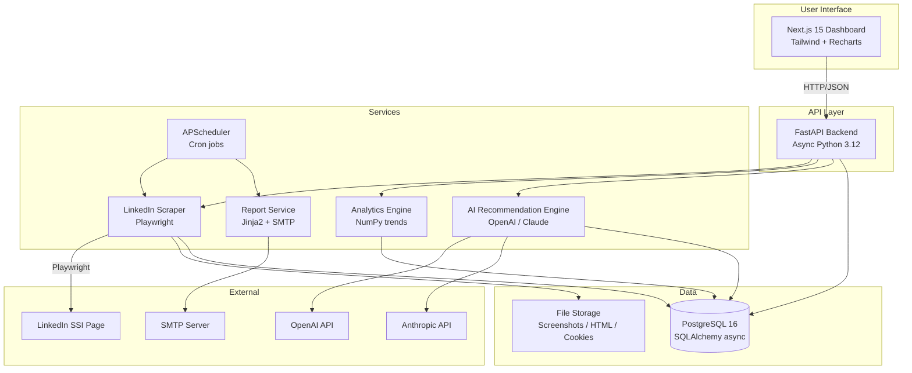
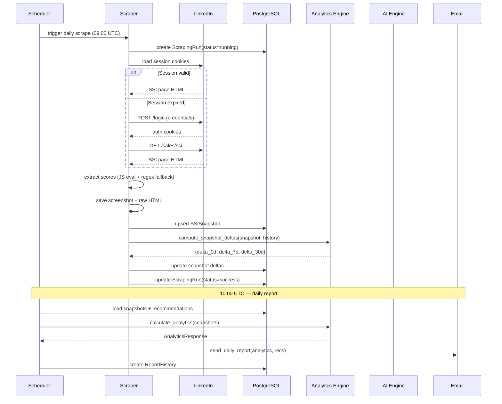

# LinkedIn SSI Intelligence Platform

Automated daily collection of LinkedIn Social Selling Index (SSI) metrics with AI-powered analysis, trend tracking, and a modern dashboard.

## Architecture



## Sequence Diagram — Daily Scrape



## Project Structure

```
linkedin-ssi-platform/
├── backend/
│   ├── alembic/               # DB migrations
│   │   └── versions/
│   │       └── 001_initial_schema.py
│   ├── app/
│   │   ├── api/
│   │   │   └── routes/
│   │   │       ├── health.py       GET /health
│   │   │       ├── ssi.py          GET /ssi/latest, /ssi/history
│   │   │       ├── analytics.py    GET /analytics, /analytics/trends
│   │   │       ├── recommendations.py
│   │   │       └── scrape.py       POST /scrape/run, GET /scrape/runs
│   │   ├── core/
│   │   │   ├── config.py           Pydantic settings
│   │   │   ├── logging.py          structlog structured logging
│   │   │   └── security.py         Fernet encryption
│   │   ├── db/
│   │   │   ├── base.py             SQLAlchemy base + mixins
│   │   │   ├── session.py          Async engine + session factory
│   │   │   └── models/
│   │   │       ├── user.py
│   │   │       ├── ssi_snapshot.py
│   │   │       ├── recommendation.py
│   │   │       ├── report_history.py
│   │   │       └── scraping_run.py
│   │   ├── schemas/                Pydantic request/response schemas
│   │   ├── services/
│   │   │   ├── linkedin_scraper.py  Playwright automation
│   │   │   ├── analytics.py         Trend analysis
│   │   │   ├── recommendation_engine.py  AI recommendations
│   │   │   └── reporting.py         Email reports
│   │   ├── scheduler.py             APScheduler cron jobs
│   │   └── main.py                  FastAPI app entrypoint
│   ├── tests/
│   └── requirements.txt
├── frontend/
│   └── src/
│       ├── app/
│       │   ├── page.tsx             Dashboard
│       │   ├── analytics/page.tsx
│       │   ├── recommendations/page.tsx
│       │   ├── history/page.tsx
│       │   └── settings/page.tsx
│       ├── components/
│       │   ├── layout/Sidebar.tsx
│       │   └── dashboard/
│       │       ├── SSIGauge.tsx     SVG circular progress gauge
│       │       ├── ComponentCard.tsx
│       │       └── TrendChart.tsx   Recharts line chart
│       ├── lib/
│       │   ├── api.ts               API client functions
│       │   └── utils.ts             Formatting helpers
│       └── types/index.ts           TypeScript interfaces
├── scripts/
│   ├── init_db.sql
│   └── seed_mock_data.py
├── docker-compose.yml
├── .env.example
└── README.md
```

## Quick Start

### Prerequisites

- Docker Desktop 4.x+
- Docker Compose v2.x
- LinkedIn account with Sales Navigator or SSI access

### 1. Clone & Configure

```bash
git clone <repo-url>
cd linkedin-ssi-platform
cp .env.example .env
```

Edit `.env` and fill in:

| Variable | Description |
|----------|-------------|
| `LINKEDIN_USERNAME` | Your LinkedIn email |
| `LINKEDIN_PASSWORD` | Your LinkedIn password |
| `AI_PROVIDER` | `openai` or `claude` |
| `OPENAI_API_KEY` | OpenAI API key (if using OpenAI) |
| `ANTHROPIC_API_KEY` | Anthropic API key (if using Claude) |
| `REPORT_TO_EMAIL` | Email to receive daily reports |
| `SMTP_USERNAME` / `SMTP_PASSWORD` | Gmail credentials |

Generate secure keys:

```bash
# SECRET_KEY
python3 -c "import secrets; print(secrets.token_hex(32))"

# ENCRYPTION_KEY (Fernet)
python3 -c "from cryptography.fernet import Fernet; print(Fernet.generate_key().decode())"
```

### 2. Launch

```bash
docker compose up -d
```

Services start up:
- **PostgreSQL** → `localhost:5432`
- **Backend API** → `localhost:8000` (with auto-migration)
- **Frontend** → `localhost:3000`
- **Scheduler** → background cron jobs

### 3. Open Dashboard

Navigate to [http://localhost:3000](http://localhost:3000)

### 4. Run First Scrape

```bash
# Via API
curl -X POST http://localhost:8000/scrape/run

# Or click "Run Scrape" in the dashboard
```

### 5. Seed Demo Data (Optional)

```bash
docker compose exec backend python /scripts/seed_mock_data.py
```

---

## API Reference

Full OpenAPI docs at [http://localhost:8000/docs](http://localhost:8000/docs)

| Method | Endpoint | Description |
|--------|----------|-------------|
| GET | `/health` | Liveness + DB check |
| GET | `/ssi/latest` | Latest SSI snapshot |
| GET | `/ssi/history` | Paginated history |
| GET | `/analytics` | Full analytics (deltas, trends, velocity) |
| GET | `/analytics/trends?days=30` | Time-series data |
| GET | `/recommendations` | List AI recommendations |
| POST | `/recommendations/generate` | Trigger AI analysis |
| PATCH | `/recommendations/{id}` | Mark read/dismissed |
| POST | `/scrape/run` | Trigger manual scrape |
| GET | `/scrape/runs` | Recent scraping runs |

---

## Local Development (without Docker)

### Backend

```bash
cd backend
python -m venv venv
source venv/bin/activate      # Windows: venv\Scripts\activate
pip install -r requirements.txt
playwright install chromium

# Start PostgreSQL (via Docker just for DB)
docker run -d --name pg -e POSTGRES_DB=ssi_db -e POSTGRES_USER=ssi \
    -e POSTGRES_PASSWORD=ssi -p 5432:5432 postgres:16-alpine

# Copy and edit env
cp ../.env.example .env

# Run migrations
alembic upgrade head

# Start API
uvicorn app.main:app --reload --port 8000
```

### Frontend

```bash
cd frontend
npm install
NEXT_PUBLIC_API_URL=http://localhost:8000 npm run dev
```

### Tests

```bash
cd backend
pip install aiosqlite  # SQLite for tests
pytest tests/ -v --cov=app --cov-report=term-missing
```

---

## Dashboard Pages

| Page | URL | Description |
|------|-----|-------------|
| Dashboard | `/` | Current score, components, trend chart, quick actions |
| Analytics | `/analytics` | Detailed tables, component trends, velocity, insights |
| Recommendations | `/recommendations` | AI-generated action plan with priorities |
| History | `/history` | Full paginated snapshot table with score bars |
| Settings | `/settings` | Credentials, AI provider, scrape history |

---

## Analytics Metrics

| Metric | Description |
|--------|-------------|
| `delta_1d` | Change vs yesterday |
| `delta_7d` | Change vs 7 days ago |
| `delta_30d` | Change vs 30 days ago |
| `avg_7d` | 7-day moving average |
| `avg_30d` | 30-day moving average |
| `trend` | `up` / `down` / `stable` (linear regression slope) |
| `velocity` | Points gained/lost per week |

---

## AI Recommendations

Recommendations are generated using GPT-4o (default) or Claude. Each recommendation includes:

- **Root cause** — why the score is low or declining
- **Recommendation** — specific LinkedIn actions to take
- **Expected impact** — projected improvement and timeframe
- **Action steps** — numbered checklist
- **Priority** — high / medium / low

To generate: click "Generate AI Recommendations" in the Recommendations page, or call `POST /recommendations/generate`.

---

## Deployment

### Production Checklist

- [ ] Change all default passwords in `.env`
- [ ] Generate proper `SECRET_KEY` and `ENCRYPTION_KEY`
- [ ] Set `ENVIRONMENT=production` and `DEBUG=false`
- [ ] Configure real SMTP credentials
- [ ] Set up SSL/TLS (add Nginx reverse proxy)
- [ ] Configure firewall — only expose ports 80/443
- [ ] Set up automated backups for PostgreSQL volume

### With Nginx (Recommended for Production)

```nginx
server {
    listen 443 ssl;
    server_name your-domain.com;

    ssl_certificate /etc/ssl/certs/your.crt;
    ssl_certificate_key /etc/ssl/private/your.key;

    location / {
        proxy_pass http://frontend:3000;
        proxy_set_header Host $host;
    }

    location /api/ {
        proxy_pass http://backend:8000/;
        proxy_set_header Host $host;
    }
}
```

---

## Security Notes

- LinkedIn credentials are stored in environment variables only, never in the database
- The browser automation runs in headless Chromium with a realistic user agent
- Session cookies are stored encrypted on the filesystem
- All data transfer between services is internal Docker networking
- The app does not bypass or circumvent LinkedIn's security — it logs in as a normal user would

---

## Troubleshooting

**Scrape fails with checkpoint error**
> LinkedIn triggered a security verification (CAPTCHA or phone verification). Log in manually once from the same IP to clear it.

**No scores extracted**
> LinkedIn may have updated their UI. Check `data/html/` for the raw page and update selectors in `linkedin_scraper.py`.

**Database connection refused**
> Wait 10-15 seconds for PostgreSQL to finish initializing. Check `docker compose logs postgres`.

**AI recommendations fail**
> Verify your `OPENAI_API_KEY` or `ANTHROPIC_API_KEY` is set and has sufficient credits.
